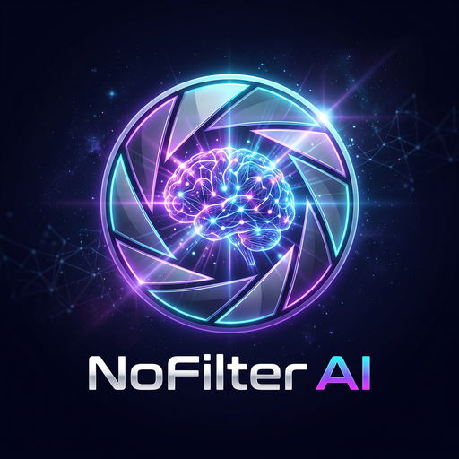

<p align="center">
  
</p>

<h1 align="center">NoFilter Ai</h1>

<p align="center">
  <strong>Unlimited, Zero-API-Key Multi-Model Ensemble AI Chatbot + Offline Neural OCR for Android</strong>
</p>

<p align="center">
  <a href="https://github.com/mirzaahmed20042004-arch/Pass/releases/download/v1.0.0/NoFilter-Ai.apk">
    <strong>⬇️ Direct Download APK (NoFilter-Ai.apk • v1.0.0 • Android 7.0+)</strong>
  </a>
</p>

---

## Why NoFilter Ai?

Most mobile AI apps lock conversations behind paid API keys, daily token caps, mandatory sign-ups, and cloud vision quotas. **NoFilter Ai** (`com.nofilter.ai`) runs a **6-expert Mixture-of-Experts (MoE) Ensemble** directly on your Android device—free, unlimited, private, and ready the instant you install the APK:

- 🧩 **6-Expert Ensemble Engine (Zero API Keys):**
  1. 🌐 **Live Web Research Expert** — Queries DuckDuckGo Instant Answers, DuckDuckGo HTML/Lite search, Bing fallback, Wikipedia REST APIs, and top result pages in real time with clickable `[1]`, `[2]` source citations.
  2. 🧠 **Offline Knowledge Base** — Instant on-device TF-IDF + phrase retrieval (`assets/web/kb.json`) across AI/ML, computer science, programming, math, physics, biology, health, history, finance, writing, and philosophy.
  3. 🧮 **Symbolic Math, Unit & Date Solver** — Exact recursive-descent evaluator (`sqrt`, trig, `log`/`ln`, exponents, percentages), unit conversions (`km`/`mi`, `kg`/`lb`, `°C`/`°F`/`K`, `MB`/`GB`), and date offsets.
  4. 💻 **Code Generator & Stack-Trace Debugger** — Generates clean code snippets and diagnoses 12+ compiler/runtime error families offline.
  5. 🔬 **Analytical & Creative Reasoner** — Extractive text summarization (`summarize: ...`), word/reading-time stats, `X vs Y` comparisons, pros/cons matrices, 4-step learning roadmaps, and poetry/micro-stories.
  6. 💾 **Persistent Memory + Trainable Personas** — Remembers anything you tell it and adapts to how you train it to behave.
- 📷 **World-Class Offline Neural OCR (Zero API Keys):**
  - Bundles **Tesseract.js v7 LSTM WebAssembly** (`tesseract-core-lstm.wasm`) + **`tessdata_best` English neural weights** (`eng.traineddata`, 15.4 MB) inside the APK.
  - Extract text from gallery screenshots or live camera photos 100% offline—and send extracted text straight into chat!
- 🎭 **Train How It Behaves (Personas Studio):**
  - 10 built-in personas (*General, Boss, Teacher, Coder, Researcher, Creative, Friend, Poet, ELI5, Concise*) + unlimited custom personas with your own behavioral instructions and tone.
- 🧠 **Memorizes Anything Forever:**
  - Auto-learns facts (`"Remember that…"`, `"My name is…"`, `"I prefer…"`) or pin any chat bubble with **⭐ Memorize this** into an on-device SQLite vault.
- 🎙️ **More Built-In Power Features:**
  - Voice input (**Speech-to-Text**) & **Read-Aloud (Text-to-Speech)**
  - Native Spannable **Markdown rendering** (headings, code blocks, bold/italic, links)
  - Power slash commands (`/help`, `/remember`, `/memories`, `/web`)
  - **Dark & Light themes** + scalable chat typography (`85%–130%`)
  - **Strict Offline Mode** toggle
  - Full **JSON Backup & Restore** (chats, memories, custom personas) + **Share Chat as Markdown**

---

## Direct APK Download

- **Direct APK URL:** [`https://github.com/mirzaahmed20042004-arch/Pass/releases/download/v1.0.0/NoFilter-Ai.apk`](https://github.com/mirzaahmed20042004-arch/Pass/releases/download/v1.0.0/NoFilter-Ai.apk)
- **Package Name:** `com.nofilter.ai`
- **Version:** `1.0.0` (`versionCode 1`)
- **Compatibility:** Android 7.0 Nougat (`API 24`) through Android 14/15+ (`targetSdk 34`), signed with **APK Signature Scheme v2 & v3**

---

## Project Specification Documents

This repository is engineered around six core specification documents:

| Document | Purpose |
| :--- | :--- |
| [`PRD.md`](PRD.md) | Product vision, target users, feature matrix, and platform requirements |
| [`ARCHITECTURE.md`](ARCHITECTURE.md) | System diagram, package breakdown, Mixture-of-Experts pipeline, loopback WASM OCR, and build pipeline |
| [`DESIGN.md`](DESIGN.md) | Conceptual neural-aperture logo, adaptive icon geometry, Dark/Light design tokens, and UX flows |
| [`MEMORY.md`](MEMORY.md) | SQLite long-term memory vault, explicit/implicit fact learning, persona training, and maintainer invariants |
| [`RULES.md`](RULES.md) | Zero-API-key guarantee, local-first privacy, loopback security, minimal harm guardrails, and APK verification rules |
| [`TASKS.md`](TASKS.md) | End-to-end milestone checklist from logo generation to signed GitHub Release |

---

## Repository Structure

```text
Pass/
├── app/
│   ├── build.gradle.kts
│   └── src/main/
│       ├── AndroidManifest.xml
│       ├── assets/web/                # Bundled kb.json + Tesseract WASM + tessdata_best eng.traineddata
│       ├── java/com/nofilter/ai/
│       │   ├── *Activity.kt           # Splash, Main, Chat, Ocr, Memory, Personas, Settings
│       │   ├── db/Db.kt               # SQLiteOpenHelper + JSON backup/restore
│       │   ├── engine/                # Ensemble, WebResearch, Knowledge, MathSolver, CodeAssist, Reasoner, PersonaMemory, Safety
│       │   ├── ocr/                   # Loopback AssetServer + WebView OcrEngine
│       │   ├── ui/Ui.kt               # Theme-aware palette & view helpers
│       │   └── util/                  # Http, Html2Text, Markdown, Prefs, Speech, Text
│       └── res/                       # Adaptive/legacy mipmaps, 32 vector/shape drawables, 9 XML layouts, Dark/Light themes
├── assets-src/logo_pick.png           # High-res conceptual artwork (2048×2048)
├── docs/logo.png                      # Showcase logo (512×512)
├── tools/
│   ├── make_icons.py                  # Generates adaptive & legacy launcher icons from logo_pick.png
│   └── build_apk.py                   # Deterministic aapt2 + kotlinc + D8 + 4-byte zipalign + apksigner pipeline
├── ARCHITECTURE.md
├── DESIGN.md
├── MEMORY.md
├── PRD.md
├── RULES.md
└── TASKS.md
```

---

## Building from Source

### Option A — Android Studio / Gradle
Open the repository root in **Android Studio Ladybug+** (or run `./gradlew assembleRelease` with Android SDK 34 installed).

### Option B — Standalone Deterministic Builder
```bash
python3 tools/make_icons.py
python3 tools/build_apk.py
# Output: release/NoFilter-Ai.apk (4-byte aligned, v2+v3 signed & verified)
```
